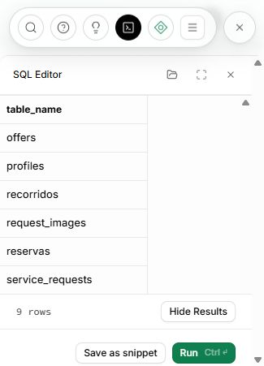

# ArreglaYa

Aplicación Flutter que conecta clientes que necesitan una reparación con técnicos que pueden enviar ofertas.

## Equipo y actividad

Actividad 03: API REST, JSON, clima y servicios de contacto; Aplicaciones Móviles I, Universidad Privada Domingo Savio.

- Fernando Adriel Montero Casanova
- María Lizeth Marcelo Claros

Docente indicado: Liber. Fecha del taller: 13/11/2026.

Repositorio: [fernando-420/arreglaya](https://github.com/fernando-420/arreglaya).

ArreglaYa busca facilitar el contacto entre personas que necesitan reparaciones y técnicos independientes. El proyecto se relaciona con el ODS 8 por su propósito de apoyar oportunidades de trabajo. Todavía no se han medido resultados económicos o de empleo.

El taller original utiliza ConectaCruz, un catálogo de negocios con consultas y reservas. En este proyecto, las solicitudes y las ofertas representan la consulta y la contratación de reparaciones. FlutterFlow no se utilizó. Estas equivalencias deben ser aceptadas por el docente y no demuestran el cumplimiento literal de todos los requisitos del ejemplo.

## Evidencias y estado



Se comprobó mediante SQL el registro, la verificación, la aceptación de una oferta y los permisos. Los datos temporales se revirtieron al terminar. La carga real del clima se verificó en un teléfono Android 15.

La ficha pública del técnico ahora consulta el clima actual de su zona con Open-Meteo, muestra temperatura, sensación térmica, humedad y viento, y permite actualizar o reintentar la consulta. Incluye botones para llamar, escribir por WhatsApp y abrir indicaciones en Google Maps. La consulta HTTP tiene un límite de 10 segundos y mensajes de error para tiempo de espera, conexión, respuesta HTTP y JSON. El resultado se transforma con `Clima.fromJson`. Los teléfonos bolivianos de ocho dígitos se normalizan con el prefijo +591.

En el teléfono físico, el 18/11/2026, Santa Cruz devolvió 31,6 °C, sensación de 33 °C, humedad del 62 %, viento de 29,1 km/h y cielo nublado. La captura está en `entregables/prueba_telefono_clima.png`. No se probaron llamada ni WhatsApp con un número real de técnico. Las notificaciones push todavía requieren el registro de dispositivos y el servicio de envío; no hay pagos integrados. Debe mejorarse la privacidad de las coordenadas exactas y la visibilidad de los teléfonos.

El cuaderno editable adaptado se encuentra en `entregables/Actividad_02_ArreglaYa_Supabase.pptx`.

## Proyecto conectado

### Confirmación del correo en Android e iOS

La app solicita que los nuevos correos regresen a `io.arreglaya.app://login-callback`. Android e iOS registran ese enlace; Supabase Flutter recibe la sesión con `app_links`, sin el manejador de rutas de Flutter.

La aplicación está configurada para el proyecto personal **arreglaya** (`prdzxcybmcxprzjsovuy`), dentro de la organización `fernando_Adriel`. En Authentication → URL Configuration se agregó `io.arreglaya.app://login-callback` a **Redirect URLs**. Se conservó el Site URL `http://localhost:3000` y la confirmación del correo debe permanecer activa. La base anterior Ruta Chiquitana (`hjmckadneaynnnrrtith`) es un proyecto separado; sus usuarios no se trasladan automáticamente.

Instalar la APK actualizada antes de abrir un nuevo correo. Los correos anteriores conservan su enlace original. Si un enlace anterior ya confirmó la cuenta antes de fallar al abrir localhost, volver a la app e ingresar con el correo y la contraseña. Para probar el regreso automático hace falta un correo nuevo enviado desde la versión actualizada, con la dirección autorizada en el panel, y abrirlo en el mismo teléfono. Este recorrido todavía requiere comprobación en un dispositivo real; la compilación por sí sola no lo verifica.

El inicio de sesión permite dos errores de correo o contraseña sin espera. Al tercer error consecutivo, deshabilita el botón durante 30 segundos con una cuenta regresiva. Un ingreso correcto o el fin de la espera reinicia el contador. Esta pausa es local a la pantalla; no sustituye los límites de Supabase y se reinicia al cerrar la app. Los errores de conexión y el límite de correos de confirmación no cuentan como contraseñas incorrectas. Las pruebas de interfaz comprueban los tres intentos y la recuperación después de la espera.

La URL y clave **publicable** del proyecto arreglaya están configuradas en `lib/main.dart`; se pueden reemplazar mediante `--dart-define`. La clave publicable se usa en la aplicación cliente y no concede permisos de administrador. Nunca pongas una clave secreta o `service_role` en Flutter.

La ampliación de esta base se aplicó mediante `supabase/upgrade_personal_project.sql`: crea el registro de imágenes faltante, mantiene RLS, refuerza permisos y añade funciones seguras de verificación/aceptación de ofertas y Realtime. La comprobación transaccional se ejecutó con `supabase/verify_installation.sql` y revirtió sus datos temporales. No vuelvas a ejecutar el esquema inicial sobre este proyecto existente.

Se conservaron las tablas `recorridos` y `reservas`. El registro de ArreglaYa envía la marca `app: arreglaya`; solo esas cuentas generan un perfil de esta app. Las cuentas de la base anterior no se migraron: los usuarios deben registrarse de nuevo en este proyecto. No se asignó ningún administrador automáticamente.

`supabase/verify_installation.sql` comprueba registro, verificación, aceptación y permisos con datos temporales dentro de una transacción que se revierte al terminar. No deja cuentas ni solicitudes de prueba guardadas.

## Actividad 03: REST, JSON y servicios de contacto

- `lib/clima_service.dart` consulta la API de geocodificación y el pronóstico actual de Open-Meteo para la zona de trabajo del técnico.
- `lib/clima.dart` tipa la respuesta JSON con `Clima.fromJson` y traduce los códigos meteorológicos a descripciones en español.
- `lib/clima_widgets.dart` muestra el clima en la ficha del técnico, con carga, errores y reintento.
- `lib/technician_contact_actions.dart` implementa llamada, WhatsApp y ruta con `url_launcher`.
- `android/app/src/main/AndroidManifest.xml` declara las consultas `tel:` y `geo:` necesarias en Android.
- `test/clima_service_test.dart` comprueba el mapeo JSON, la búsqueda de zona y los errores HTTP y de tiempo de espera.
- `test/clima_widgets_test.dart` comprueba que al actualizar sin conexión se quite el clima anterior y se muestre el error.
- Las capturas 12-A y 12-B enviadas están en `entregables/evidencias/`.

El endpoint y las variables actuales están documentados en [Open-Meteo](https://open-meteo.com/en/docs) y [su API de geocodificación](https://open-meteo.com/en/docs/geocoding-api). Las acciones externas utilizan [`url_launcher`](https://pub.dev/packages/url_launcher).

Entregables: `entregables/Actividad_03_ArreglaYa_API.pptx`, `entregables/prueba_telefono_clima.png`, `entregables/Actividad_03_ArreglaYa_60s.mp4` y `entregables/ArreglaYa_Actividad3.apk`. El MP4 dura aproximadamente 60 segundos y no tiene narración. El PPTX descargable conserva las diapositivas como imágenes para mantener su diseño; el texto no es editable y la versión editable sigue en el espacio de la presentación. La APK local es de depuración ARM64, versión `1.0.1+2002`, no una compilación firmada para publicación en Play Store, y se mantiene local en `entregables/` por su tamaño.

## Pago con QR del Banco Económico (prueba)

Una oferta aceptada se puede pagar con un QR del Banco Económico: botón **«Pagar con QR»** en la tarjeta de la oferta. Las claves del banco no van en la app. Las guarda un servidor Node.js aparte, en [`servidor-pagos/`](servidor-pagos/LEEME.md). La app se compila con su dirección:

```powershell
flutter build apk --debug --dart-define=PAGOS_URL=http://IP-DE-LA-PC:3100
```

Sin `PAGOS_URL` el botón no aparece. Por defecto el servidor cobra **Bs 1** por QR (`MONTO_PRUEBA=1`), para probar sin pagar el precio de la oferta. Ver [`servidor-pagos/LEEME.md`](servidor-pagos/LEEME.md).

## Configurar otro proyecto de Supabase

1. Crea un proyecto en [Supabase](https://supabase.com/dashboard).
2. Abre **SQL Editor** y ejecuta todo el archivo [`supabase/schema.sql`](supabase/schema.sql).
3. En **Authentication > Providers > Email**, para una demostración rápida puedes desactivar **Confirm email**. Para producción debe mantenerse activo.
4. En **Project Settings > API**, copia la **Project URL** y la clave pública **Publishable** (o `anon` si tu panel aún la muestra). Nunca uses `service_role` en la aplicación.

## Ejecutar en el teléfono conectado

```powershell
flutter run --dart-define=SUPABASE_URL=https://TU-PROYECTO.supabase.co --dart-define=SUPABASE_ANON_KEY=TU_CLAVE_PUBLICA
```

## Crear APK de demostración

```powershell
flutter build apk --debug --dart-define=SUPABASE_URL=https://TU-PROYECTO.supabase.co --dart-define=SUPABASE_ANON_KEY=TU_CLAVE_PUBLICA
```

El APK se genera en `build/app/outputs/flutter-apk/app-debug.apk`.

## Actualización de seguridad y aceptación de ofertas

Antes de instalar esta versión sobre un proyecto existente:

1. Comprueba que estén aplicados `schema.sql` y los archivos de `supabase/migrations` en orden, del 002 al 010. El esquema inicial por sí solo no contiene todas las funciones de la app.
2. Ejecuta `supabase/security_upgrade.sql` completo en el SQL Editor. Protege el rol y la verificación de los perfiles y añade las funciones `accept_offer` y `verify_technician` que usa esta versión.
3. Distribuye la nueva app después de aplicar el SQL. Las versiones anteriores ya no podrán aceptar ofertas ni verificar técnicos mediante actualizaciones directas.

La aceptación comprueba al dueño de la solicitud y la verificación del técnico, bloquea la solicitud durante la operación, acepta una sola oferta y rechaza las demás en la misma transacción. Un índice impide guardar dos ofertas aceptadas para la misma solicitud.

Si ya existen solicitudes con varias ofertas aceptadas, el script se detendrá sin aplicar cambios. Revísalas y resuelve qué oferta corresponde antes de volver a ejecutarlo:

```sql
select request_id, array_agg(id order by id) as accepted_offer_ids
from public.offers
where status = 'aceptada'
group by request_id
having count(*) > 1;
```

Comprueba con cuentas de prueba que un cliente no pueda cambiar su rol o su verificación, que solo el administrador pueda verificar técnicos y que dos clientes de la app intentando aceptar ofertas distintas de una solicitud dejen una sola oferta aceptada. Comprueba también que el dueño pueda editar sus datos de contacto.

Las notificaciones push siguen pendientes: la inicialización de Firebase no incluye registro de dispositivos ni un servicio de envío. No se han activado avisos automáticos con esta actualización.
